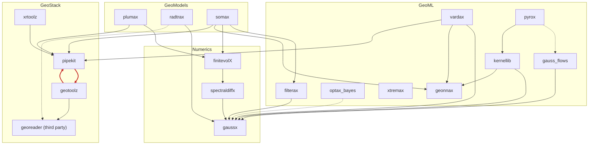

# GeoStack

[](https://github.com/jejjohnson/geostack/actions/workflows/ci.yml)
[](https://jejjohnson.github.io/geostack)
[](https://opensource.org/licenses/MIT)
[](https://www.python.org/downloads/)
[](https://pixi.sh)
[](https://dvc.org)

> A JAX-native research software stack for geophysical modeling, inference and data assimilation.

## Features

- 🐍 **Python 3.12+** with modern type annotations
- 📦 **[Pixi](https://pixi.sh)** for reproducible conda-forge environments across platforms
- 📊 **[DVC](https://dvc.org)** for data versioning and ML pipeline management
- ⚙️ **[Hydra](https://hydra.cc)** + **[hydra-zen](https://mit-ll-responsible-ai.github.io/hydra-zen/)** for type-safe configuration management
- 📓 **[JupyterLab](https://jupyterlab.readthedocs.io)** with LSP, Git integration, and MyST rendering
- 📝 **[Jupytext](https://jupytext.readthedocs.io)** — notebooks stored as diff-friendly `.py` files, convert to `.ipynb` on demand
- 🌊 **[Marimo](https://marimo.io)** reactive notebook environment
- 📚 **[MyST-MD](https://mystmd.org)** for publication-quality documentation
- 🔍 **[Ruff](https://docs.astral.sh/ruff/)** for fast linting and formatting
- 🔒 **Pre-commit hooks** for code quality enforcement
- 🚀 **15 GitHub Actions workflows** for CI/CD, reproducibility, and automation
- 🖥️ **Cross-platform** support (Linux x86-64, macOS ARM64)
- 📝 **[CITATION.cff](https://citation-file-format.github.io/)** for academic citations
- 🔬 **Hydra multirun** sweeps for hyperparameter optimization
- 🤖 **Agent-ready**: [`AGENTS.md`](AGENTS.md) holds the rules every coding agent follows (with the example-specific passages marked for rewriting), [`CODE_REVIEW.md`](CODE_REVIEW.md) the review checklist, [`docs/api/capabilities.md`](docs/api/capabilities.md) indexes every public name in the upstream libraries (`make capabilities`), and `.claude/` holds step-by-step skills (adopt the template, add an experiment / dataset / model / notebook, reproduce and write up results) and two read-only reviewers

## Project Structure

```
geostack/
├── .github/workflows/    # 15 GitHub Actions workflows
├── .devcontainer/        # VS Code / Codespaces dev container
├── data/                 # Data directories (DVC-managed)
│   ├── raw/
│   ├── processed/
│   └── external/
├── docs/                 # MyST documentation
├── marimo_notebooks/     # Marimo reactive notebooks
├── notebooks/            # Jupyter notebooks
├── results/              # Experiment results (DVC-managed)
├── references/           # Git submodules, one folder per layer:
│   ├── geostack/         #   pipekit, geotoolz, xrtoolz, georeader
│   ├── numerics/         #   gaussx, finitevolX, spectraldiffx
│   ├── geoml/            #   geonnax, kernellib, optax_bayes, filterax, vardax,
│   │                     #   gauss_flows, xtremax, pyrox
│   └── geomodels/        #   plumax, somax, radtrax
├── scripts/              # Entry point scripts (no local package: see references/)
└── tests/                # Test suite
```

## Reference libraries

geostack has no package of its own. It builds on eighteen libraries in four
layers, pinned as git submodules under `references/<layer>/` and installed
into pixi from there. GeoStack is in every environment; the other layers
each have one (`pixi run -e numerics|geoml|geomodels …`). Edges between
layers point down: GeoModels → GeoML → Numerics, and both upper layers may
use GeoStack.

| Submodule | Repository | Provides |
|---|---|---|
| `references/geostack/pipekit` | [jejjohnson/pipekit](https://github.com/jejjohnson/pipekit) | Carrier-agnostic operator-graph framework, plus `-array`, `-cycle`, `-evaluate`, `-experiment`, `-jax`, `-train` |
| `references/geostack/geotoolz` | [jejjohnson/geotoolz](https://github.com/jejjohnson/geotoolz) | Remote-sensing operators on GeoTensor, plus `-catalog`, `-cloud`, `-patcher`, `-products` |
| `references/geostack/xrtoolz` | [jejjohnson/xrtoolz](https://github.com/jejjohnson/xrtoolz) | Operators for xarray data cubes, plus `-core`, `-einx`, `-grad`, `-reader`, `-sklearn` |
| `references/geostack/georeader` | [spaceml-org/georeader](https://github.com/spaceml-org/georeader) | Raster reading and the GeoTensor carrier |
| `references/numerics/gaussx` | [jejjohnson/gaussx](https://github.com/jejjohnson/gaussx) | Structured linear algebra and Gaussian primitives on lineax |
| `references/numerics/finitevolX` | [jejjohnson/finitevolX](https://github.com/jejjohnson/finitevolX) | Arakawa C-grid finite-volume operators |
| `references/numerics/spectraldiffx` | [jejjohnson/spectraldiffx](https://github.com/jejjohnson/spectraldiffx) | Pseudospectral differentiation, filters and PDE solvers |
| `references/geoml/geonnax` | [jejjohnson/geonnax](https://github.com/jejjohnson/geonnax) | Basis functions, neural layers and coordinate transforms in Equinox |
| `references/geoml/kernellib` | [jejjohnson/kernellib](https://github.com/jejjohnson/kernellib) | Covariance kernels and scalable kernel methods |
| `references/geoml/optax_bayes` | [jejjohnson/optax_bayes](https://github.com/jejjohnson/optax_bayes) | The Bayesian learning rule as optax transformations |
| `references/geoml/filterax` | [jejjohnson/filterax](https://github.com/jejjohnson/filterax) | Differentiable ensemble Kalman filters and smoothers |
| `references/geoml/vardax` | [jejjohnson/vardax](https://github.com/jejjohnson/vardax) | Variational data assimilation (BLUE/OI, 3D-Var, 4D-Var, …) |
| `references/geoml/gauss_flows` | [jejjohnson/gauss_flows](https://github.com/jejjohnson/gauss_flows) | Gaussianization (RBIG) and normalizing flows |
| `references/geoml/xtremax` | [jejjohnson/xtremax](https://github.com/jejjohnson/xtremax) | Extreme-value and point-process models |
| `references/geoml/pyrox` | [jejjohnson/pyrox](https://github.com/jejjohnson/pyrox) | Equinox + NumPyro: GPs, Bayesian NNs, latent Gaussian models (`pyrox`, `-gp`, `-lgm`, `-nn`) |
| `references/geomodels/plumax` | [jejjohnson/plumax](https://github.com/jejjohnson/plumax) | Plume transport: Gaussian plume and puff, Lagrangian, LES |
| `references/geomodels/somax` | [jejjohnson/somax](https://github.com/jejjohnson/somax) | Simple ocean and atmosphere models |
| `references/geomodels/radtrax` | [jejjohnson/radtrax](https://github.com/jejjohnson/radtrax) | Differentiable radiative transfer for methane remote sensing |

The capability indexes list their public API, one page per layer:
[GeoStack](docs/api/capabilities.md),
[Numerics](docs/api/capabilities_numerics.md),
[GeoML](docs/api/capabilities_geoml.md),
[GeoModels](docs/api/capabilities_geomodels.md).
To move a reference forward: `git submodule update --remote references/<layer>/<name>`,
then `pixi lock`, `make capabilities`, and commit the submodule, `pixi.lock`
and the indexes together (or push and let `pixi-lock.yml` do the last two).

### How they depend on one another

<!-- dependency-graph:begin -->
<!-- Generated by scripts/dependency_graph.py; do not edit by hand. -->



18 repositories, 36 packages and 29 dependencies between repositories, from each submodule's `pyproject.toml` and imports. Solid arrows are base dependencies or imports, dashed ones extras; an arrow a longer path implies is not drawn. Dev, docs and tutorial dependency groups are not library dependencies and are left out. Red arrows form a cycle.

<!-- dependency-graph:end -->

The rules that keep this graph free of cycles (each one is checked by
`tests/test_dependency_graph.py`; the reasons, and where the graph breaks
them today, are on the [dependency graph page](docs/api/dependency_graph.md)):

1. **Layers point down.** GeoModels → GeoML → Numerics / GeoStack; GeoStack
   and Numerics never import each other.
2. **Within a layer, tiers point down.** A repository imports only lower
   tiers of its own layer; the GeoModels repositories never import each other.
3. **Every library edge counts:** base dependencies, extras and imports,
   including lazy, `try`-guarded and `TYPE_CHECKING` ones; dev, docs and
   tutorial dependency groups do not.
4. **No cycles,** between repositories or between the packages of a workspace.
5. **Every import is declared:** module-level imports as base dependencies,
   lazy or guarded ones as extras.
6. **Fix a reverse edge by moving code, never by a shim:** move the primitive
   down or the adapter up, and leave no re-export behind.
7. **georeader is a leaf:** third-party, depended on and never changed.
8. **A new repository arrives with its place:** its layer and tier go into
   `TIERS` in `scripts/dependency_graph.py` in the same pull request.

Regenerate the diagram with `make dependency-graph`.

## Quick Start

### Prerequisites

Install [Pixi](https://pixi.sh):

```bash
curl -fsSL https://pixi.sh/install.sh | bash
```

### Installation

```bash
git clone --recurse-submodules https://github.com/jejjohnson/geostack
cd geostack
# already cloned? git submodule update --init
pixi install
```

## Environments

| Environment | Features | Use Case |
|-------------|----------|----------|
| `default` | dev | Testing, linting, training |
| `docs` | docs | Building MyST documentation |
| `jupyterlab` | dev + jupyterlab | Interactive notebooks |
| `marimo` | dev + marimo | Reactive notebooks |

```bash
# Activate specific environment
pixi run -e jupyterlab lab
pixi run -e marimo marimo-edit
pixi run -e docs docs-build
```

## Configuration Management

Experiments use [Hydra](https://hydra.cc) and [hydra-zen](https://mit-ll-responsible-ai.github.io/hydra-zen/): every setting of a run lives in `configs/` (added with the first experiment) and is overridable on the command line. See the `add-experiment` skill.

## Experiment Tracking

This project uses [DVC](https://dvc.org) for data and experiment tracking.

```bash
# Add data to DVC
dvc add data/raw/dataset.csv

# Run the full pipeline
dvc repro

# Check pipeline status
dvc status

# View pipeline DAG
dvc dag

# Compare metrics across experiments
dvc metrics diff
```

The DVC pipeline is defined in `dvc.yaml` (no stages yet).

## Documentation

Documentation is built with [MyST-MD](https://mystmd.org) using the book theme.

```bash
# Serve locally with live reload
pixi run -e docs docs-serve

# Build static HTML
pixi run -e docs docs-build
```

Docs are automatically deployed to GitHub Pages on every push to `main`.

## Notebook Environments

Notebooks are stored as [Jupytext](https://jupytext.readthedocs.io) percent-format
`.py` scripts — not `.ipynb` files. This keeps the repository clean, diff-friendly,
and free of committed cell outputs. Generated `.ipynb` files are gitignored.

### Converting to .ipynb

```bash
# Convert all notebooks/ scripts to .ipynb
pixi run notebooks-to-ipynb

# Convert a single file
pixi run jupytext --to notebook notebooks/01_eda.py

# Keep .py and .ipynb in sync while editing (paired mode)
pixi run -e jupyterlab jupytext --set-formats py:percent,ipynb notebooks/01_eda.py
```

### JupyterLab

Full-featured JupyterLab with LSP, Git integration, MyST rendering, and spell checking:

```bash
pixi run -e jupyterlab lab
```

### Marimo

Reactive, reproducible notebooks in pure Python:

```bash
pixi run -e marimo marimo-edit
```

Marimo notebooks in `marimo_notebooks/` are also stored as `.py` files,
making them diff-friendly and importable as regular Python modules.

## CI/CD Workflows

| Workflow | Trigger | Description |
|----------|---------|-------------|
| `ci.yml` | push/PR | pytest on ubuntu + macos |
| `lint.yml` | push/PR | Ruff linting |
| `typecheck.yml` | push/PR | ty type checking |
| `pages.yml` | push to main | Build + deploy MyST docs |
| `dvc-check.yml` | DVC file changes | Validate DVC pipeline |
| `notebooks.yml` | notebook changes | Validate Jupytext .py notebooks |
| `reproducibility.yml` | weekly schedule | Full `dvc repro` |
| `experiment-report.yml` | PR | DVC metrics diff comment |
| `citation.yml` | CITATION.cff changes | Validate citation file |
| `pixi-update.yml` | monthly schedule | Update pixi lockfile |
| `codeql.yml` | push/PR/schedule | Security scanning |
| `conventional-commits.yml` | PR | Validate PR title |
| `label-pr.yml` | PR | Auto-label PRs |
| `pre-commit-autoupdate.yml` | weekly schedule | Update pre-commit hooks |
| `release-please.yml` | push to main | Open release PRs, tag releases, update `CHANGELOG.md` and versions |

## Academic

### Citation

If you use this software, please cite it using the metadata in `CITATION.cff`:

```bibtex
@software{johnson2026geostack,
  author = {Johnson, J. Emmanuel},
  title  = {GeoStack},
  year   = {2026},
  url    = {https://github.com/jejjohnson/geostack},
}
```

### References

Add BibTeX references to `references.bib`. They are automatically available
in MyST documentation and Jupyter notebooks with the `jupyterlab-myst` extension.

### Zenodo

Connect your GitHub repository to [Zenodo](https://zenodo.org) for automatic
DOI assignment on releases.

## Acknowledgments

This template was inspired by:
- [jejjohnson/pypackage_template](https://github.com/jejjohnson/pypackage_template) — library-focused Python package template
- [DrivenData Cookiecutter Data Science](https://drivendata.github.io/cookiecutter-data-science/)
- [Hydra documentation](https://hydra.cc/docs/intro/)
- [DVC documentation](https://dvc.org/doc)
