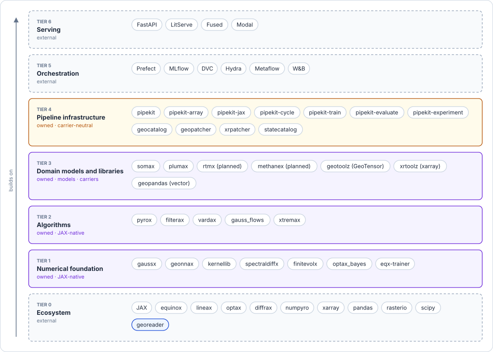
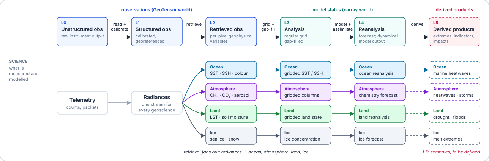
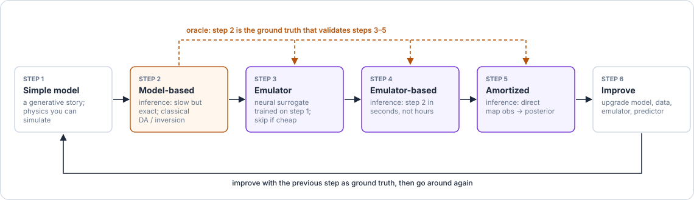
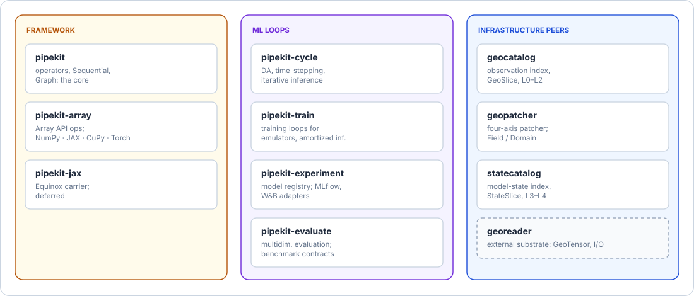
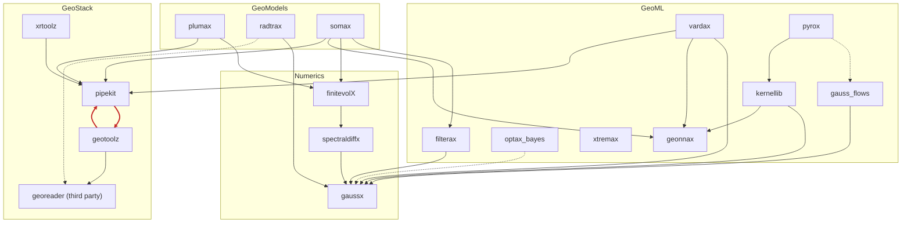
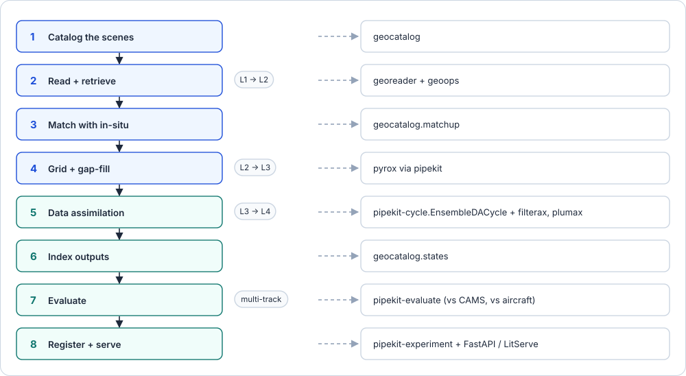

<p align="center">
  <picture>
    <source media="(prefers-color-scheme: dark)" srcset="docs/assets/logo-dark.svg">
    
  </picture>
</p>

<p align="center">
  <a href="https://github.com/jejjohnson/geostack/actions/workflows/ci.yml"></a>
  <a href="https://jejjohnson.github.io/geostack"></a>
  
  <a href="https://pixi.sh"></a>
  <a href="https://dvc.org"></a>
  <a href="https://opensource.org/licenses/MIT"></a>
</p>

<p align="center">
  <a href="https://jejjohnson.github.io/geostack/"><b>Docs</b></a> ·
  <a href="docs/overview.md"><b>Overview</b></a> ·
  <a href="docs/api/capabilities.md"><b>Capability indexes</b></a> ·
  <a href="docs/api/dependency_graph.md"><b>Dependency graph</b></a> ·
  <a href="docs/benchmarks_gallery.md"><b>Benchmarks</b></a>
</p>

**A JAX-native research stack for geophysical modeling, inference and data assimilation.**

GeoStack takes Earth observations from raw telemetry to derived products:
retrieval, gap-filling, data assimilation and extremes, with physics and
machine learning in the same differentiable pipelines. It is eighteen
libraries in four layers. This repository is their umbrella: the design,
the experiments and the write-up. It has no package of its own; thin
scripts and notebooks compose the libraries, Hydra configs hold every
setting, a DVC pipeline ties data, code and results together, and MyST
writes it up.

<p align="center">
  
</p>

## The problem

Every geoscience product climbs the same ladder of processing levels, and
each step up is an inverse problem: calibrate counts into radiances,
retrieve geophysical variables, grid and gap-fill them, assimilate them into
a model, derive the extremes and indicators people act on. Observations
travel as GeoTensors (rasters with georeferencing) up to L2; from L3 on,
model states travel as xarray cubes.

<p align="center">
  
</p>

The same five steps carry every one of those transitions from research to
production: a simple model, classical inference as the trusted oracle, an
emulator, inference on the emulator, and an amortized map straight from
observations to the posterior. Step 2 scores steps 3 to 5, and step 6
improves any of them against the step before it.

<p align="center">
  
</p>

Every lifecycle step crossed with every stage is a concrete method, and a
benchmark: the [overview](https://jejjohnson.github.io/geostack/overview#sec-axes-relate) walks a running
example through each row, from detector counts to heatwave return levels.

## The layers

| Layer | Library | Provides |
|---|---|---|
| **GeoStack** · data in, data out | [pipekit](https://github.com/jejjohnson/pipekit) | Carrier-agnostic operator-graph framework, plus `-array`, `-cycle`, `-evaluate`, `-experiment`, `-jax`, `-train` |
| | [geotoolz](https://github.com/jejjohnson/geotoolz) | Remote-sensing operators on GeoTensor, plus `-catalog`, `-cloud`, `-patcher`, `-products` |
| | [xrtoolz](https://github.com/jejjohnson/xrtoolz) | Operators for xarray data cubes, plus `-core`, `-einx`, `-grad`, `-reader`, `-sklearn` |
| | [georeader](https://github.com/spaceml-org/georeader) | Raster reading and the GeoTensor carrier (third-party, read-only here) |
| **GeoNumerics** · structured numerics | [gaussx](https://github.com/jejjohnson/gaussx) | Structured linear algebra and Gaussian primitives on lineax |
| | [finitevolX](https://github.com/jejjohnson/finitevolX) | Arakawa C-grid finite-volume operators |
| | [spectraldiffx](https://github.com/jejjohnson/spectraldiffx) | Pseudospectral differentiation, filters and PDE solvers |
| **GeoML** · learning and inference | [geonnax](https://github.com/jejjohnson/geonnax) | Basis functions, neural layers and coordinate transforms in Equinox |
| | [kernellib](https://github.com/jejjohnson/kernellib) | Covariance kernels and scalable kernel methods |
| | [optax_bayes](https://github.com/jejjohnson/optax_bayes) | The Bayesian learning rule as optax transformations |
| | [filterax](https://github.com/jejjohnson/filterax) | Differentiable ensemble Kalman filters and smoothers |
| | [vardax](https://github.com/jejjohnson/vardax) | Variational data assimilation (BLUE/OI, 3D-Var, 4D-Var, …) |
| | [gauss_flows](https://github.com/jejjohnson/gauss_flows) | Gaussianization (RBIG) and normalizing flows |
| | [xtremax](https://github.com/jejjohnson/xtremax) | Extreme-value and point-process models |
| | [pyrox](https://github.com/jejjohnson/pyrox) | Equinox + NumPyro: GPs, Bayesian NNs, latent Gaussian models (`pyrox`, `-gp`, `-lgm`, `-nn`) |
| **GeoModels** · physics | [plumax](https://github.com/jejjohnson/plumax) | Plume transport: Gaussian plume and puff, Lagrangian, LES |
| | [somax](https://github.com/jejjohnson/somax) | Simple ocean and atmosphere models |
| | [radtrax](https://github.com/jejjohnson/radtrax) | Differentiable radiative transfer for methane remote sensing |

Each library is a git submodule under `references/<layer>/<name>`, installed
into pixi from there: GeoStack in every environment, each other layer in its
own (`pixi run -e numerics|geoml|geomodels …`). The capability indexes list
every public name, one page per layer:
[GeoStack](docs/api/capabilities.md),
[GeoNumerics](docs/api/capabilities_numerics.md),
[GeoML](docs/api/capabilities_geoml.md),
[GeoModels](docs/api/capabilities_geomodels.md).
Search them before writing a helper: reusable code goes upstream, into the
library that owns it, never into this repository.

Inside GeoStack, one pipekit core carries two carriers, and the same jobs
run on both:

<p align="center">
  
</p>

### How they depend on one another

<!-- dependency-graph:begin -->
<!-- Generated by scripts/dependency_graph.py; do not edit by hand. -->



18 repositories, 36 packages and 29 dependencies between repositories, from each submodule's `pyproject.toml` and imports. Solid arrows are base dependencies or imports, dashed ones extras; an arrow a longer path implies is not drawn. Dev, docs and tutorial dependency groups are not library dependencies and are left out. Red arrows form a cycle.

<!-- dependency-graph:end -->

The rules that keep this graph free of cycles (each one is checked by
`tests/test_dependency_graph.py`; the reasons, and where the graph breaks
them today, are on the [dependency graph page](docs/api/dependency_graph.md)):

1. **Layers point down.** GeoModels → GeoML → Numerics / GeoStack; GeoStack
   and Numerics never import each other.
2. **Within a layer, tiers point down.** A repository imports only lower
   tiers of its own layer; in GeoModels only plumax imports another (radtrax).
3. **Every library edge counts:** base dependencies, extras and imports,
   including lazy, `try`-guarded and `TYPE_CHECKING` ones; dev, docs and
   tutorial dependency groups do not.
4. **No cycles,** between repositories or between the packages of a workspace.
5. **Every import is declared,** as a base dependency or an extra (an extra
   for optional modules and lazy or guarded imports), or listed with its
   reason in `UNDECLARED_OK`.
6. **Fix a reverse edge by moving code, never by a shim:** move the primitive
   down or the adapter up, and leave no re-export behind.
7. **georeader is a leaf:** third-party, depended on and never changed.
8. **A new repository arrives with its place:** its layer and tier go into
   `TIERS` in `scripts/dependency_graph.py` in the same pull request.

Regenerate the diagram with `make dependency-graph`.

## A worked example: methane

The canonical pipeline runs from EMIT imaging-spectrometer scenes to an
hourly methane analysis, with TCCON columns as in-situ truth and CAMS and
aircraft campaigns as references. The [overview](https://jejjohnson.github.io/geostack/overview#sec-walkthrough)
states each stage's problem and its code.

<p align="center">
  
</p>

## Quick start

Install [pixi](https://pixi.sh), then clone with the submodules:

```bash
curl -fsSL https://pixi.sh/install.sh | bash
git clone --recurse-submodules https://github.com/jejjohnson/geostack
cd geostack                       # already cloned? git submodule update --init
pixi install                      # the default environment: GeoStack
make install                      # the uv developer loop and pre-commit hooks
```

| Environment | Holds | Run with |
|---|---|---|
| `default` | GeoStack, Hydra, DVC, the dev tools | `pixi run test` |
| `numerics` | + GeoNumerics | `pixi run -e numerics …` |
| `geoml` | + GeoNumerics, GeoML | `pixi run -e geoml …` |
| `geomodels` | + GeoNumerics, GeoML, GeoModels | `pixi run -e geomodels …` |
| `docs` | MyST | `pixi run -e docs docs-build` |
| `jupyterlab`, `marimo` | notebooks | `pixi run -e jupyterlab lab`, `pixi run -e marimo marimo-edit` |

## Working in the repo

```bash
make test               # pytest, through pixi
make lint               # ruff check . (the entire repo)
make typecheck          # ty check scripts
make capabilities       # regenerate the four capability indexes
make dependency-graph   # regenerate the graph above and its page
make docs               # build the MyST site; make docs-serve for a live preview
pixi run dvc repro      # the pipeline, from raw data to metrics
make help               # every target
```

- **Configs.** Every setting of a run lives in `configs/`
  ([Hydra](https://hydra.cc) + [hydra-zen](https://mit-ll-responsible-ai.github.io/hydra-zen/)),
  overridable on the command line; no literal in a script.
- **Pipeline.** [DVC](https://dvc.org) stages in `dvc.yaml` declare every
  input and output, so every number in the docs regenerates from a commit
  (`dvc repro`, `dvc metrics diff`).
- **Notebooks.** [Jupytext](https://jupytext.readthedocs.io) percent-format
  `.py` files in `notebooks/` (`pixi run notebooks-to-ipynb` makes the
  `.ipynb` locally) and [marimo](https://marimo.io) apps in
  `marimo_notebooks/`; no `.ipynb` is committed.
- **Docs.** [MyST](https://mystmd.org) pages under `docs/`, deployed to
  GitHub Pages on every push to `main`; the overview's figures come from
  `docs/images/overview/make_figures.py`.
- **Agents.** [`AGENTS.md`](AGENTS.md) holds the rules every coding agent
  follows, [`CODE_REVIEW.md`](CODE_REVIEW.md) the review checklist, and
  `.claude/` the step-by-step skills (add an experiment, dataset, model or
  notebook; reproduce and write up results) and two read-only reviewers.

```
geostack/
├── references/   # the eighteen libraries, one folder per layer (git submodules)
├── scripts/      # entry points; no local package
├── configs/      # Hydra configs (with the first experiment)
├── dvc.yaml      # the pipeline
├── data/         # DVC-managed: raw/, processed/, external/
├── results/      # DVC-managed: metrics/, figures/, tables/
├── notebooks/    # jupytext notebooks
├── marimo_notebooks/
├── docs/         # MyST documentation, the overview and its figures
└── tests/        # the capability indexes, the dependency graph, the guards
```

<details>
<summary>CI workflows</summary>

| Workflow | Trigger | What it does |
|---|---|---|
| `ci.yml` | push / PR | pytest on Ubuntu and macOS, per layer |
| `lint.yml` | push / PR | ruff, and the read-only submodule guard |
| `typecheck.yml` | push / PR | ty |
| `pixi-lock.yml` | feature branches | regenerates `pixi.lock` and the capability indexes |
| `pages.yml` | push to `main` | builds and deploys the MyST site |
| `dvc-check.yml` | pipeline changes | `dvc status` and `dvc dag` |
| `experiment-report.yml` | PR | a comment with `dvc metrics diff` and `dvc params diff` |
| `reproducibility.yml` | weekly | the whole pipeline, `dvc repro` |
| `notebooks.yml` | notebook changes | the jupytext notebooks parse |
| `citation.yml` | `CITATION.cff` changes | the citation file validates |
| `conventional-commits.yml` | PR | the PR title is a Conventional Commit |
| `label-pr.yml` | PR | labels the PR |
| `codeql.yml` | push / PR / weekly | security scanning |
| `pixi-update.yml` | monthly | updates the pixi lockfile |
| `pre-commit-autoupdate.yml` | weekly | updates the pre-commit hooks |
| `release-please.yml` | push to `main` | release PRs, tags, `CHANGELOG.md` |

</details>

## Citation

If you use GeoStack, please cite it with the metadata in
[`CITATION.cff`](CITATION.cff):

```bibtex
@software{johnson2026geostack,
  author = {Johnson, J. Emmanuel},
  title  = {GeoStack},
  year   = {2026},
  url    = {https://github.com/jejjohnson/geostack},
}
```

## Acknowledgments

The repository started from a research-project template inspired by
[jejjohnson/pypackage_template](https://github.com/jejjohnson/pypackage_template)
and [Cookiecutter Data Science](https://drivendata.github.io/cookiecutter-data-science/).
